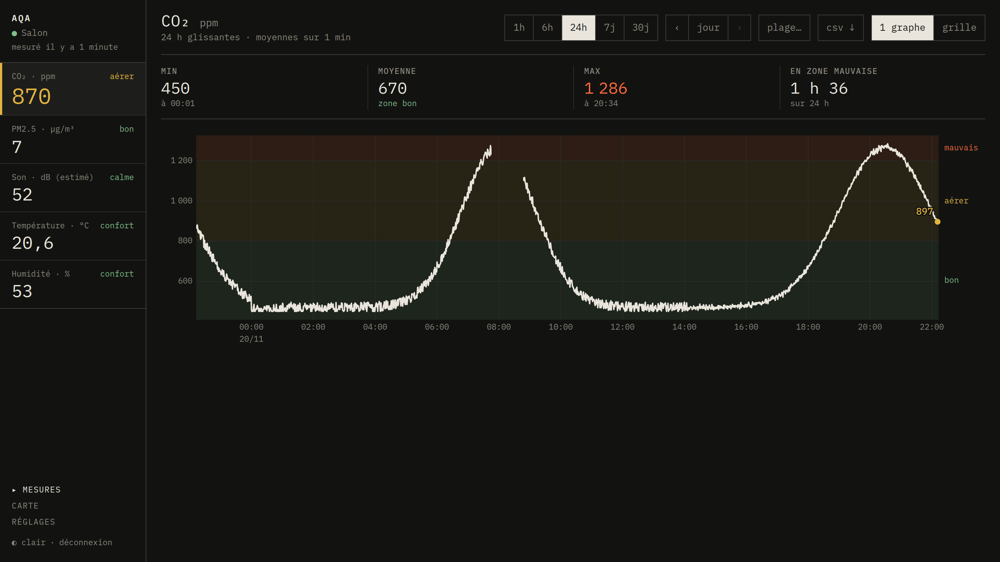
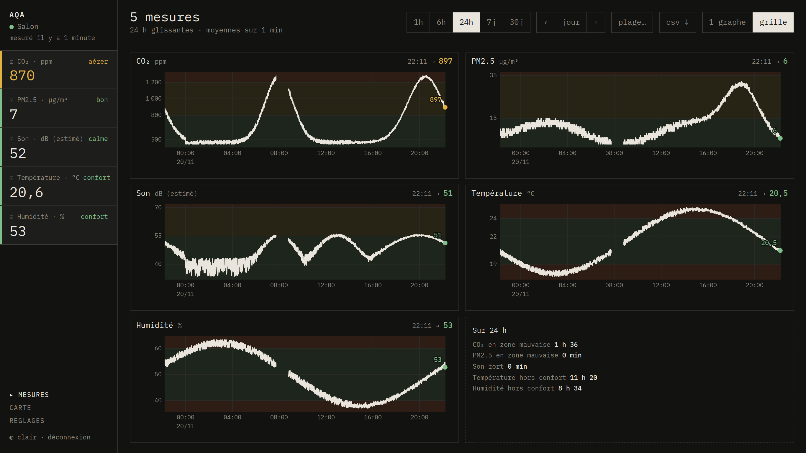
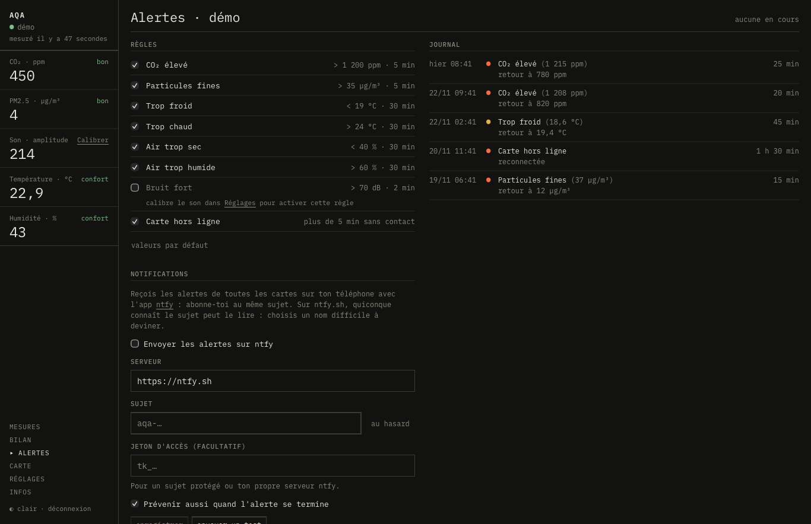
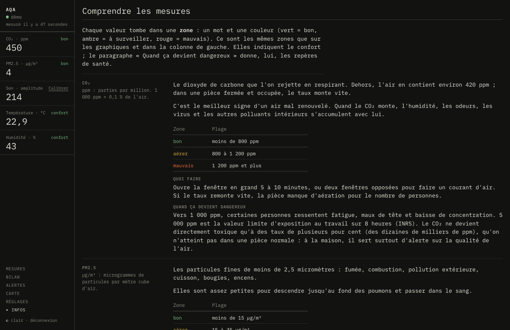
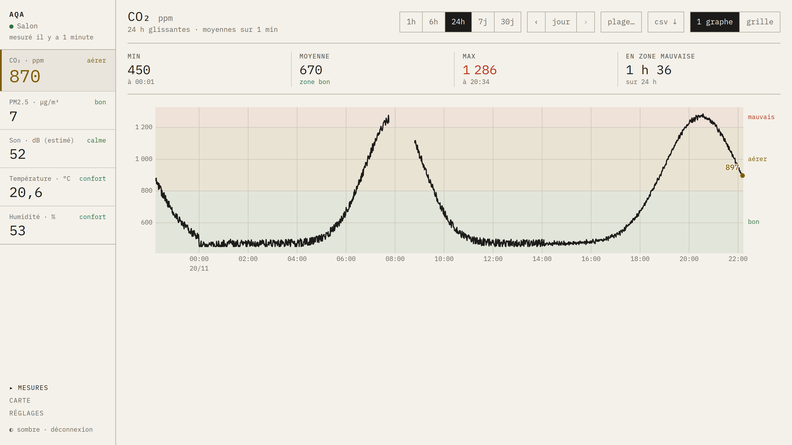
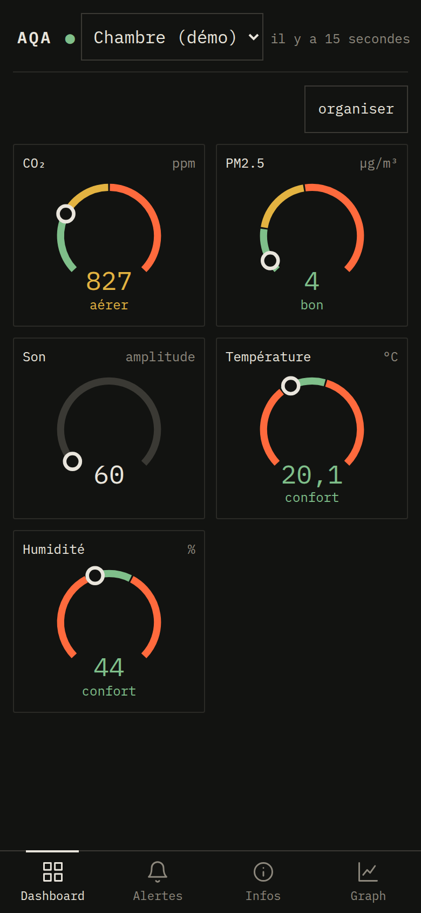

# AQA — know what you're breathing

AQA is a small box that watches the air in a room (a bedroom, a living room, a
classroom, an office) and a website that tells you, in plain words, whether
that air is good and what to do when it isn't.

Leave the box in the room. Open the website on your computer or your phone. You
see right away whether the air is good, how it has been all day, and when it's
time to open a window. You don't need to know what "1,200 ppm" means.

*The interface is in French.*

## What it measures

| | What it tells you |
|---|---|
| **CO₂** | How stale the air is. It rises when people stay in a closed room, and it's the clearest sign you need to air the room. |
| **Fine particles** | Smoke, dust and pollution: tiny particles that get deep into the lungs. |
| **Temperature** | Whether the room is comfortable, too cold or too warm. |
| **Humidity** | Whether the air is too dry (sore throat, static) or too damp (mould). |
| **Noise** | How loud the room is. |

## Reading it at a glance

Every value falls in a **zone**, and each zone has a word and a colour:

| | Good | Watch it | Bad |
|---|---|---|---|
| CO₂ | under 800 ppm (*bon*) | 800–1,200 (*aérer*, air the room) | over 1,200 (*mauvais*) |
| Fine particles | under 15 µg/m³ | 15–35 | over 35 (WHO guideline) |
| Temperature | 19–24 °C (*confort*) | | colder or warmer |
| Humidity | 40–60 % (*confort*) | | drier or damper |
| Noise | under 55 dB (*calme*) | 55–70 dB (*bruyant*) | over 70 dB (*fort*) |

The charts use the same colours: green at the bottom, amber in the middle, red
at the top, with each zone's name written on the side. One look shows where the
air is now and where it has been all day.

## What you can do with it

### See the air right now, and how it has been

The five current values stay in view on every page, each with its zone word.
Click one to see its history over the last hour, the day, the month or any
dates you choose. Under the chart: the lowest, the average, the highest, and
**how long the air stayed in the bad zone**.

Want everything at once? The grid puts all the measurements side by side. Point
at a moment on one chart and every chart shows that same moment.

You can also download all the measurements as a spreadsheet.

### Your week in one sentence

The **Report** tab (*Bilan*) answers "was my week good, and what should I
change?":

- one sentence first, such as *"Bonne semaine : l'air a été bon 86 % du temps"*
  (good week: the air was good 86 % of the time);
- for each measurement, how long it spent in each zone, and whether it did
  better or worse than the week before;
- CO₂ hour by hour, one row per day, so habits jump out: the evening peak, the
  stuffy morning;
- two or three things to remember, in plain words: *"CO₂ goes over 1,200 ppm
  almost every evening around 9 pm: air the room before going to bed."*

Switch between the week and the month, and go back to earlier ones.

### Get warned on your phone

When the air stays bad for a while (too much CO₂, too cold, too damp, the box
unplugged…), an **alert** opens with a concrete tip such as *"open a window wide
for 5 to 10 minutes"*. The Alerts page (*Alertes*) keeps the list of past
alerts. You choose which ones you want and how sensitive they are.

To receive them on your phone even when the website is closed, install the free
[ntfy](https://ntfy.sh) app and pick the same channel name in the app and in
AQA. Each notification says which room it comes from, what's wrong and what to
do, and another one tells you when things are back to normal.

### Understand what the numbers mean

The **Info** tab (*Infos*) explains each measurement in everyday words: where it
comes from, what each zone means, what to do about it, and from what level it
becomes a real health concern, with its sources.

### Look after the box from anywhere

The **Board** page (*Carte*) tells you whether the box is online, how good its
Wi-Fi signal is, whether each sensor is working, and what happened recently
(restarts, lost connection, a sensor that stopped answering). From there you can
restart it or update it without unplugging anything.

In **Settings** (*Réglages*) you can rename the box, move it to another Wi-Fi
network, and tune the noise sensor in a minute with a free sound-meter app on
your phone.

### On your phone, in the dark or in the light

The website opens in dark mode and switches to light in one click. On a phone
it has its own layout: one gauge per measurement (press and hold to reorder
them), the report, the alerts, the state of the box, and a full-screen chart
when you turn the phone sideways. Controlling the box and changing settings
stay on the computer.

  
  &nbsp;
  

## Your data stays yours

Everything stays on your own server, behind your own password. Nothing is sent
to anyone else, except the phone notifications if you turn them on.

## Make your own

You need two things: the box, and somewhere to run the website.

- **The box**: its parts, wiring and software are in
  [Tpouch/EPITECH_ESP32](https://github.com/Tpouch/EPITECH_ESP32).
- **The website**: how to install it, connect a box to it and everything
  technical is in **[DEVELOPERS.md](DEVELOPERS.md)**.
