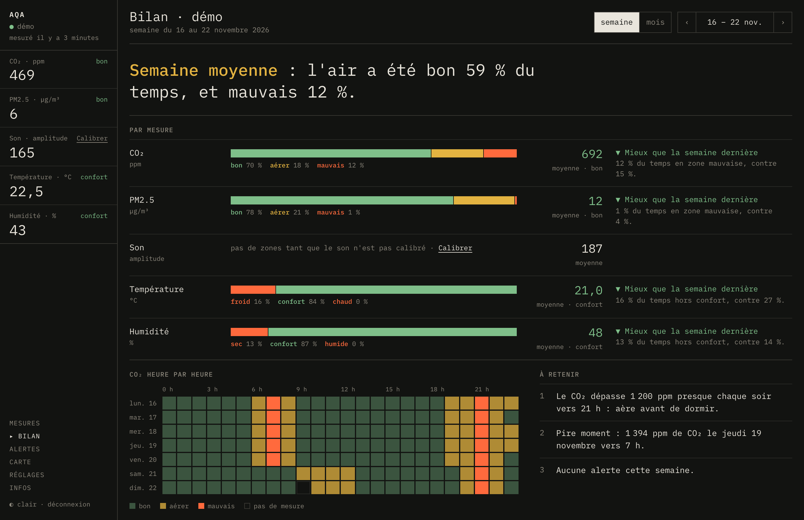
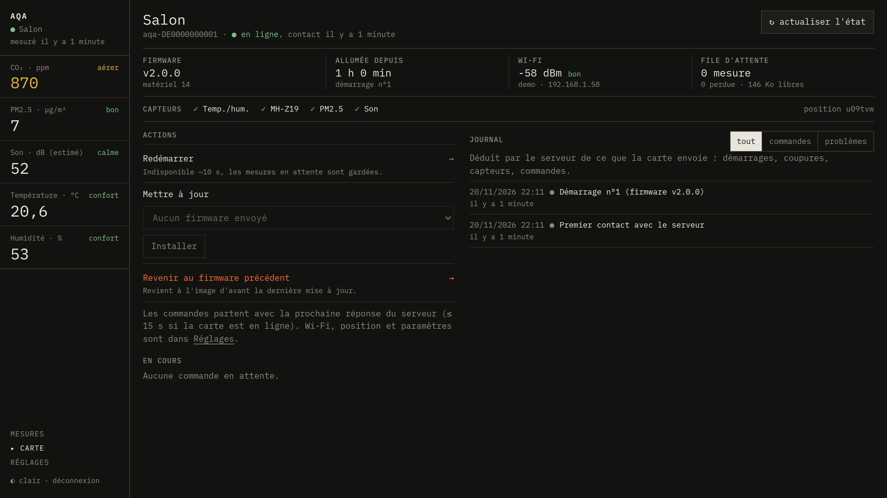
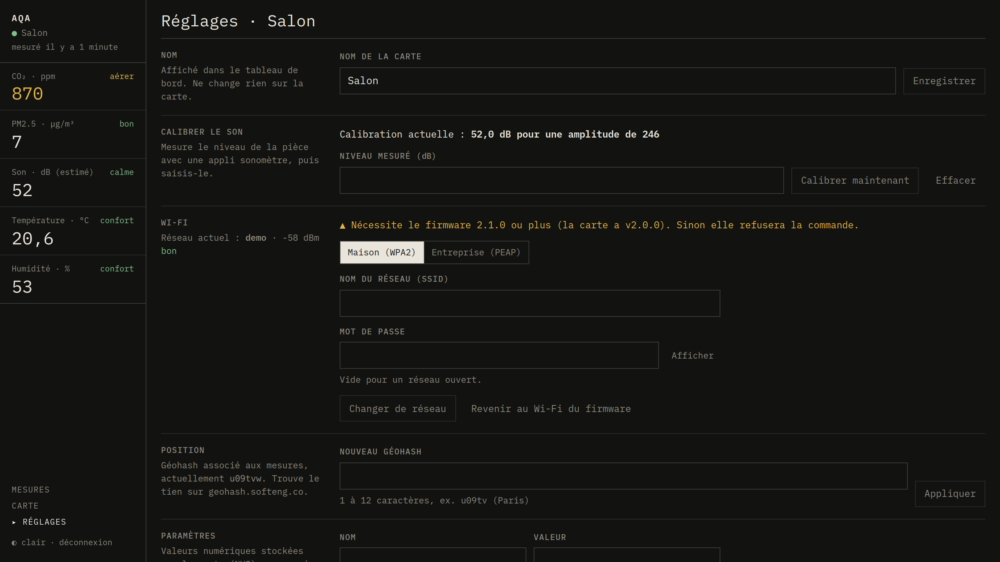

# AQA — know what you're breathing

AQA is a small air-quality station for a room (a living room, a bedroom, a
classroom, an office), and this repository is the website that goes with it.

The station is an ESP32 board with four sensors. Every 15 seconds it measures
the air and sends the numbers to this app. The app keeps the history and draws
it as charts anyone can read at a glance. It also tells you plainly when it's
time to open a window.

> Looking for the board itself? The firmware, the wiring and the build
> instructions are in **[Tpouch/EPITECH_ESP32](https://github.com/Tpouch/EPITECH_ESP32)**.

## What it measures

| | What it tells you |
|---|---|
| **CO₂** | How stale the air is. It rises when people stay in a closed room, and it's the clearest sign you need to ventilate. |
| **Fine particles (PM2.5)** | Smoke, dust and pollution: tiny particles that get deep into the lungs. |
| **Temperature** | Whether the room is comfortable, too cold or too warm. |
| **Humidity** | Whether the air is too dry (sore throat, static) or too damp (mould). |
| **Noise** | How loud the room is, in estimated decibels once the board is calibrated. |

## Reading it at a glance

Every value falls in a **zone**, and each zone has a word, so you never need to
know what "1,200 ppm" means:

| | Good | Watch it | Bad |
|---|---|---|---|
| CO₂ | under 800 ppm (*bon*) | 800–1,200 (*aérer*, ventilate) | over 1,200 (*mauvais*) |
| Fine particles | under 15 µg/m³ | 15–35 | over 35 (WHO guideline) |
| Temperature | 19–24 °C (*confort*) | | colder or warmer |
| Humidity | 40–60 % (*confort*) | | drier or damper |
| Noise | under 55 dB (*calme*) | 55–70 dB (*bruyant*) | over 70 dB (*fort*) |

The charts use the same zones: green at the bottom, amber in the middle, red at
the top, with each zone's name written on the side. One look shows where the air
is now and where it has been all day.

*The interface itself is in French.*

## Features

### Live readings, always in view

The left column shows the five current values with their zone word, on every
page. Click one to see its history.

### One big chart, or all of them at once

Pick a period: the last hour up to the last 30 days, a specific day, or any range
you like. Below the chart you get the minimum, the average, the maximum and
**how long the air spent in the bad zone**. Switch to the grid to compare every
measurement side by side on one screen. Hover over one chart and all of them
show the same moment.

You can download everything as a spreadsheet (CSV).

### A report for the week or the month

The **Report** tab (*Bilan*) answers "was my week good, and what should I
change?" without a single number to decode:

- one sentence first, such as *"Bonne semaine : l'air a été bon 86 % du temps"*
  (a good week: the air was good 86 % of the time), coloured by how it went;
- one line per measurement: how long it spent in each zone, its average, and
  whether it did better or worse than the week before;
- CO₂ hour by hour, one row per day, so habits show up at a glance (the
  evening peak, the morning before everyone leaves);
- two or three things to remember, in plain words: *"CO₂ goes over 1,200 ppm
  almost every evening around 10 pm: air the room before going to bed."*, the
  worst moment of the week, the number of alerts.

Switch between the calendar week and the calendar month, and step back to
earlier ones. Hours when the board was off are shown as "no measurement" and
never counted as good air.

### Look after the board from your browser

The **Board** page (*Carte*) shows:

- whether the station is online,
- its Wi-Fi signal,
- which sensors are working,
- a log of what happened: restarts, lost connections, sensors that stopped answering.

From there you can restart the board or install a new firmware version without
plugging in a cable.

### Settings

From the Settings page you can:

- rename the board,
- move it to another Wi-Fi network,
- set its location,
- calibrate the noise sensor with a sound-meter app on your phone,
- upload new firmware versions.

### Dark or light, desktop or phone

The app opens in dark mode and switches to light in one click. On a phone it
has its own layout: a dashboard of gauges you can reorder (long press, then
drag), the weekly report, the alerts, the board's state (read only) and a
full-screen chart to view in landscape. Board commands and settings stay on the desktop.

  
  &nbsp;
  

## Getting started

1. **Build the station** by following the
   [EPITECH_ESP32](https://github.com/Tpouch/EPITECH_ESP32) repository.
2. **Run this app** on a server and choose an admin password. It ships as a
   single Docker container.
3. **Register the board** in the app. It gives you a secret key to put in the
   board's settings before you flash it. Boards that are already trying to
   connect show up in the list on their own.

Step-by-step instructions, configuration and the API are in
**[DEVELOPERS.md](DEVELOPERS.md)**.

## Privacy

Everything stays on your own server. There is one admin account, each board
signs in with its own secret key, and nothing is sent to anyone else.
